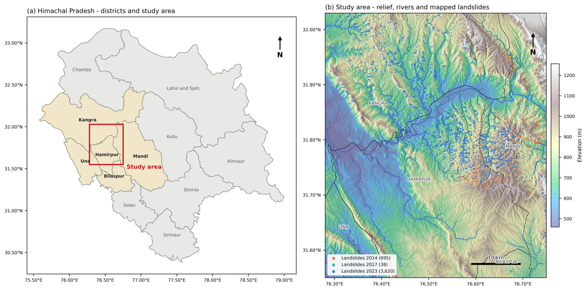
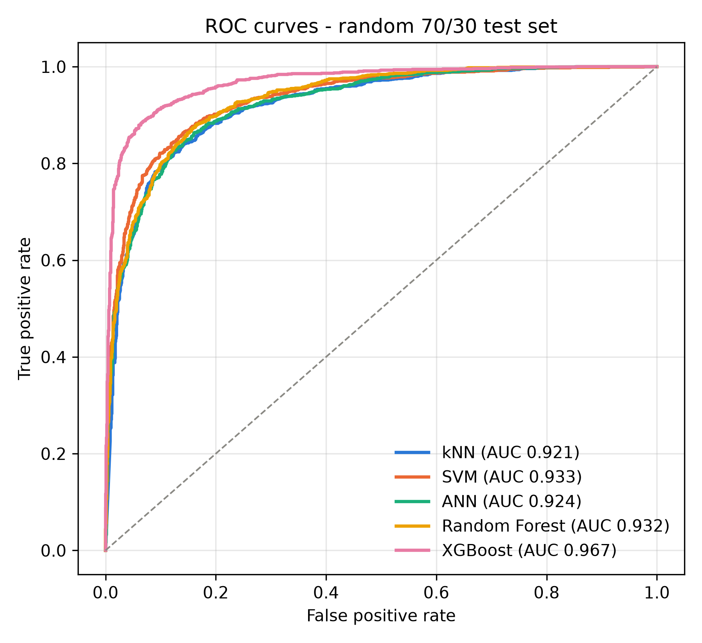
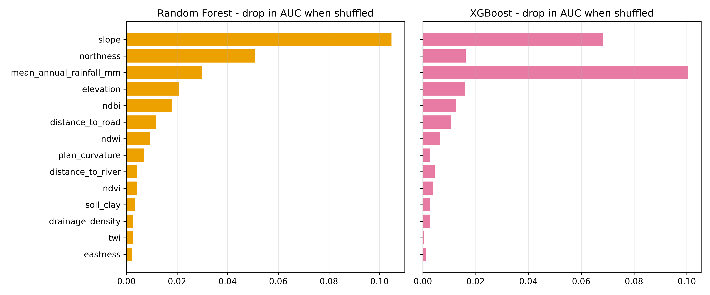
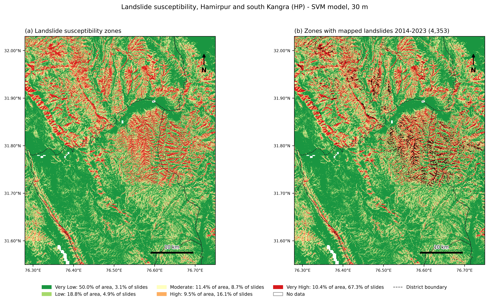
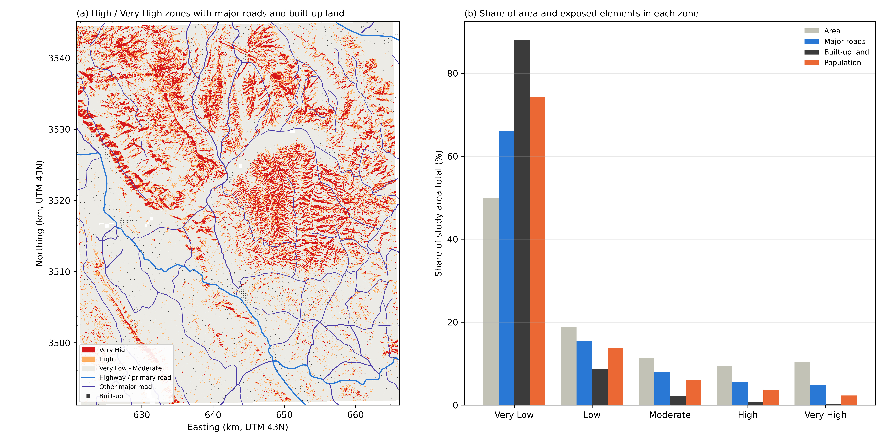

# 1. What the project does, in one paragraph

Every monsoon, rain-triggered landslides block roads and damage homes in the Shivalik hills of Himachal Pradesh. This project builds a map that shows, for every 30 m square of ground in a 2,360 km² area around Hamirpur, how likely a landslide is there. It learns that from 4,431 landslides that ISRO's Bhuvan portal mapped after the 2014, 2017 and 2023 monsoons, using fourteen properties of the ground (slope, rainfall, vegetation, distance to roads and rivers, and others) read from satellite data in Google Earth Engine. Five machine-learning models are compared, and the one that predicts best **on areas it has never seen** (a tuned support vector machine) draws the final map. The map is then overlaid with roads, buildings and population to show what is exposed and which road stretches need protection first.

# 2. The question and the objectives

**Question:** given what the ground looks like before a monsoon, where are landslides most likely to happen?

1. Build a landslide inventory and a set of conditioning factors for the study area.
2. Train and compare machine-learning models that separate landslide from non-landslide ground.
3. Produce a 30 m susceptibility map divided into five zones and check it against the mapped landslides.
4. Find which factors drive the predictions.
5. Turn the map into a spatial risk framework: which roads, built-up land and people lie in the dangerous zones.

# 3. Study area

- **Box:** 76.28-76.75°E, 31.55-32.03°N, about 2,360 km². It covers almost all of Hamirpur district and parts of Kangra, Mandi, Una and Bilaspur, along the Beas River.
- **Why here:** the first choice, Kinnaur, had too few mapped landslides to train a model. Hamirpur has the highest density of mapped landslides in the state (about 178 per 100 km²). A sliding-window search showed the densest area of this size sits just north-west of Hamirpur, so the box was moved 0.15° north. That raised the landslides inside it from 3,214 to 4,431.
- **Ground conditions:** weakly cemented sandstones, conglomerates and clays of the Shivalik hills, about 1,860 mm of rain a year, mostly in the monsoon.
- **Projection:** all raster work is done in UTM zone 43N (EPSG:32643), so slopes and distances are true ground values.

# 4. Data

| Dataset | Source | Resolution | Used for |
|---|---|---|---|
| Seasonal landslide inventory 2014, 2017, 2023 | NRSC/ISRO Bhuvan | polygons | landslide points |
| Landsat 5/7 (2005-08), Sentinel-2 (2015-17, 2022-24) | USGS, ESA | 10-30 m | NDVI, NDWI, NDBI |
| SRTM DEM | NASA | 30 m | elevation, slope, aspect, plan curvature |
| MERIT Hydro | Yamazaki et al. (2019) | ~90 m | wetness index (TWI), drainage density, distance to river |
| GRIP4 roads | Meijer et al. (2018) | vector | distance to road |
| Soil clay content | OpenLandMap | 250 m | soil factor |
| CHIRPS rainfall 2009-2025 | UCSB Climate Hazards Center | ~5.5 km | mean annual rainfall |
| MODIS NDVI, ERA5-Land, GHSL population, ESA WorldCover, USGS earthquakes | various | various | context and exposure (Cells 16-17) |

**Getting the inventory.** Bhuvan shows the landslide polygons on its map but has no download button. Its map server still answers a standard WMS `GetFeatureInfo` request ("what is at this pixel?"). Asking that question for the whole state squeezed into a single 1x1 pixel returns every polygon in the layer with its attributes. One request per season gave 14,664 landslides for Himachal Pradesh, of which 4,431 fall in the study box (698 in 2014, 39 in 2017, 3,694 in 2023). All are recorded as rainfall-triggered.

# 5. Method, step by step

Everything runs in one Jupyter notebook (`study_area/Hamirpur.ipynb`). Each step below names its notebook cell.

**Step 1. Satellite composites (Cells 3-5).** Clouds and cloud shadows are masked out of every scene, and the median of all clear pixels is taken for three periods: ~2006 (102 Landsat scenes), ~2016 (79 Sentinel-2 scenes; Sentinel-2 surface reflectance starts in 2017 here) and ~2024 (415 scenes). From each composite three indices are computed:

- **NDVI** (vegetation): high for dense forest.
- **NDWI** (water and wetness).
- **NDBI** (built-up and bare ground).

**Step 2. Static factors (Cells 6-8).** Ten layers that do not change between periods: elevation, slope, aspect, plan curvature, TWI, drainage density, distance to river, distance to road (capped at 5 km), soil clay and mean annual rainfall. Together with the three indices they form a 13-band image per period.

Two data decisions here:

- **Aspect is circular.** 0° and 359° both mean north, but a model would see them as far apart. Aspect is therefore replaced by northness (cos) and eastness (sin), giving **14 model inputs**.
- **Rainfall uses 2009-2025 only.** CHIRPS gives about 466 mm a year over this area for 2001-2008 but 1,862 mm afterwards. ERA5-Land, an independent dataset, shows no such jump (1,350 vs 1,604 mm), so the early CHIRPS years are a data problem, not a change in climate.

**Step 3. Training points (Cell 10).**

- Landslides whose centres fall in the same 30 m pixel are merged, leaving 4,353 landslide points. This stops the same location appearing in both training and test data.
- The same number of **non-landslide** points is generated 0.5-3 km from the nearest mapped landslide: off the slides, but inside the area Bhuvan actually mapped, so "no landslide" really means "mapped and found stable".
- Non-landslide points get seasons in the same proportion as landslides, so each season is roughly balanced.

**Step 4. Reading factor values (Cell 11).** Each point takes its 13 values from imagery taken **before** its landslide season (2014 points use ~2006 imagery; 2017 and 2023 points use ~2016). Otherwise the model could simply "see" fresh landslide scars in the vegetation index. Ten points fell on no-data pixels and were dropped: **8,696 points** remain, with no missing values.

**Step 5. Model comparison (Cell 12).** Five classifiers: k-nearest neighbours (kNN), support vector machine (SVM), a small neural network (ANN), random forest and XGBoost. kNN, SVM and ANN get standardised inputs; the SVM's scores are turned into probabilities with `CalibratedClassifierCV`. Each model is tested three ways:

- **Test A, random 70/30 split.** The usual textbook test.
- **Test B, spatial block cross-validation.** The area is cut into ~5 km blocks, and whole blocks are held out in 5 folds. This mimics the real use of the map: predicting ground with no recorded landslides.
- **Test C, temporal.** Train on 2014 and 2017, test on 2023.

**Metrics:** ROC-AUC (how well the model ranks landslide points above stable ones; 0.5 is a coin toss, 1.0 is perfect), overall accuracy (OA), F1 and Cohen's kappa (agreement beyond chance).

**Step 6. Tuning (Cell 13).** 15% of points are held out as a final test set. On the other 85%, each model gets a random search over 20 settings, scored by 5-fold spatial block CV, so tuning cannot reward memorising locations.

**Step 7. Mapping (Cell 14).** The best model is applied to all 2.62 million 30 m pixels using the ~2024 imagery. Probabilities are split into five zones at 0.2 steps: Very Low, Low, Moderate, High, Very High. Each zone is checked with the **frequency ratio**: its share of landslides divided by its share of area (above 1 means more landslides than its size alone would suggest).

**Step 8. Context and risk (Cells 16-17).** Vegetation, rainfall, population and earthquake history over 2001-2025; then roads, built-up land and population are counted in each zone and each district.

# 6. Results

## 6.1 Model comparison: random splits flatter the models

| Model | A: random | B: spatial blocks | C: 2014+2017 → 2023 | OA under B |
|---|---|---|---|---|
| kNN | 0.921 | 0.876 | 0.765 | 79.3% |
| SVM | 0.933 | 0.886 | 0.782 | 81.1% |
| ANN | 0.924 | **0.901** | 0.767 | 82.0% |
| Random Forest | 0.932 | 0.875 | 0.813 | 78.5% |
| XGBoost | **0.967** | 0.851 | **0.824** | 74.9% |

ROC-AUC with default settings (`Results/model_comparison.csv`).

- On the random split every model looks excellent and XGBoost is clearly best.
- When whole blocks are held out, every model gets worse and **the ranking flips**: ANN first, XGBoost last. XGBoost loses the most (0.116 AUC). Nearby points have nearly identical values, so a flexible tree model can partly memorise places; that only shows up when it is tested on new places.
- On the temporal test the models still reach 0.77-0.82 on the 2023 season, which was far more extreme and uses Sentinel-2 instead of Landsat for its imagery.

## 6.2 Tuning and the final model

| Model | Spatial AUC, default → tuned | OA tuned | Kappa tuned |
|---|---|---|---|
| kNN | 0.876 → 0.888 | 80.7% | 0.61 |
| **SVM** | **0.886 → 0.905** | **83.0%** | **0.66** |
| ANN | 0.901 → 0.901 | 82.0% | 0.64 |
| Random Forest | 0.875 → 0.875 | 78.6% | 0.57 |
| XGBoost | 0.851 → 0.860 | 77.1% | 0.54 |

- Tuning helps only a little (at most 0.019 AUC, for the SVM), so the defaults were already reasonable.
- XGBoost's random-test score went **down** after tuning (0.969 → 0.934) while its spatial score went up (0.851 → 0.860): the tuned version over-fits less.
- **Final model: tuned SVM**, RBF kernel, C = 1.31, gamma = 0.027. Spatial ROC-AUC 0.905, OA 83.0%, kappa 0.66 ("substantial" on the Landis and Koch scale). Its smooth decision boundary seems to carry over to new areas better than the tree models.
- All tuned models are within 0.05 AUC of each other: **the sampling and testing design matters more than the choice of algorithm.**

## 6.3 Which factors matter

- **Slope** ranks first in random forest and second in XGBoost, as expected from slope-stability mechanics.
- **Rainfall** ranks first in XGBoost and third in random forest. But the 5.5 km CHIRPS grid has only a few distinct values over the area, so it may partly act as a location label.
- **Northness** ranks second in random forest, possibly because north- and south-facing slopes differ in moisture and vegetation.
- **NDBI and distance to road** point to the effect of road cuts and built-up land.
- TWI, drainage density and soil clay matter least, probably because their source data are coarse (90-250 m).

Importance was computed for random forest and XGBoost on the Test A split.

## 6.4 The susceptibility map

| Zone | Area (km²) | Area % | Landslides | Landslides % | Frequency ratio |
|---|---|---|---|---|---|
| Very Low | 1,179.5 | 50.0 | 133 | 3.1 | 0.06 |
| Low | 443.0 | 18.8 | 212 | 4.9 | 0.26 |
| Moderate | 268.4 | 11.4 | 380 | 8.7 | 0.77 |
| High | 223.2 | 9.5 | 699 | 16.1 | 1.70 |
| Very High | 246.3 | 10.4 | 2,928 | 67.3 | 6.45 |

- Half of the area is Very Low; 19.9% is High or Very High.
- The frequency ratio rises steadily from 0.06 to 6.45, and 83.3% of the mapped landslides fall in the High and Very High zones.
- Red and orange follow the steep, dissected hills east of the Beas and the Shivalik ridges; green is valleys and terraces.
- These landslides were also used for training, so this is a consistency check, not an independent test. The independent evidence is the spatial CV in 6.1-6.2.

## 6.5 Change over time and earthquakes

- **Vegetation:** mean NDVI rose from about 0.57 (2001-05) to 0.64 (2021-25): the area got greener. The 2023 landslides were **not** concentrated where vegetation was lost (frequency ratio 0.66 in the least-greening fifth vs 1.27 in the most-greening fifth).
- **Rainfall in landslide seasons:** monsoon rain was 1,693 mm in 2014, 1,248 mm in 2017 and 1,601 mm in 2023 (2009-25 average 1,518 mm).
- **Population:** about 845,000 in 2005 and 972,000 in 2025 (+15%).
- **Earthquakes:** 101 events of M3+ within 150 km since 2005. The four M5+ events were 134-149 km away; the only notable one in a landslide season was an M4.9 on 21 Aug 2014, about 60 km away. With every landslide recorded as rainfall-triggered, earthquakes are unlikely to explain them.

## 6.6 Risk framework: what is exposed

- The High and Very High zones (19.9% of the area) contain **71.9 km of major roads (10.5%)**, 0.46 km² of built-up land (1.0%) and **about 57,000 people (6.0%)**.
- Most people and buildings sit in the Very Low zone (74% of people, 88% of built-up land), on terraces and valley floors. **Roads are more exposed** than settlements because they have to cross the hills.
- By district, the Kangra part of the box has the most High and Very High ground (28.2%), then Mandi (22.8%) and Hamirpur (13.7%).
- **40 road stretches** of 300 m or more (17.5 km in total, 37 of them tertiary roads) run through High or Very High ground. These are the first candidates for slope protection and drainage work (`Results/priority_road_stretches.csv`).

# 7. Limitations

- **No lithology input.** Bhuvan's attributes show 76.6% of the slides are in coarse sandstone and boulder-conglomerate units, but no geology layer is available in Earth Engine and GSI Bhukosh maps come one toposheet at a time.
- **2023 dominates** the inventory (about 83% of slides), and the 2017 season has only 39.
- **Coarse inputs:** rainfall at ~5.5 km, soil at 250 m and hydrology at ~90 m limit what those factors can show.
- **The ~2016 composite is effectively 2017**, because Sentinel-2 surface reflectance starts then over India.
- **The frequency-ratio check is not independent** of the training data.
- **Geotechnical strength parameters** (cohesion c, friction angle φ) are not yet part of the model.

# 8. Conclusions

1. A 30 m landslide susceptibility map for Hamirpur and south Kangra was built from 4,431 Bhuvan landslides and 14 satellite-derived factors.
2. Random train/test splits overstate accuracy for spatial data. Under spatial block CV the ranking of models changes, and the best random-split model (XGBoost) becomes the worst.
3. The tuned SVM is the final model: spatial ROC-AUC 0.905, OA 83.0%, kappa 0.66.
4. Slope, rainfall and northness drive the predictions.
5. About a fifth of the area is High or Very High susceptibility. It holds few people but a tenth of the major roads; 40 road stretches (17.5 km) are flagged for protection.

**Next steps:** add a lithology layer, use a finer rainfall product (IMD gridded data), bring in geotechnical parameters, and test the map against the next monsoon's inventory when Bhuvan publishes it.

# 9. Glossary

- **Landslide susceptibility:** how likely a place is to have a landslide, based on its ground conditions. It says *where*, not *when*.
- **Conditioning factor:** a property of the ground used as a model input (slope, rainfall, etc.).
- **NDVI / NDWI / NDBI:** normalised-difference indices from satellite bands for vegetation, water and built-up land.
- **TWI:** topographic wetness index, where water tends to collect.
- **ROC-AUC:** probability that the model ranks a random landslide point above a random stable point.
- **Cohen's kappa:** accuracy corrected for agreement expected by chance.
- **Spatial block cross-validation:** testing on whole geographic blocks left out of training, so the model cannot lean on nearby, near-identical points.
- **Frequency ratio:** a zone's share of landslides divided by its share of area.
- **Permutation importance:** the drop in score when one factor's values are shuffled.

# References

- Funk, C., et al. (2015). The climate hazards infrared precipitation with stations. *Scientific Data*, 2, 150066.
- Landis, J.R., Koch, G.G. (1977). The measurement of observer agreement for categorical data. *Biometrics*, 33, 159-174.
- Meijer, J.R., et al. (2018). Global patterns of current and future road infrastructure. *Environmental Research Letters*, 13, 064006.
- NRSC/ISRO. Bhuvan Disaster Services: Seasonal Landslide Inventory Mapping, Himachal Pradesh (2014, 2017, 2023). Accessed 3 October 2026.
- Pedregosa, F., et al. (2011). Scikit-learn: Machine learning in Python. *JMLR*, 12, 2825-2830.
- Roberts, D.R., et al. (2017). Cross-validation strategies for data with temporal, spatial, hierarchical, or phylogenetic structure. *Ecography*, 40, 913-929.
- Yamazaki, D., et al. (2019). MERIT Hydro: a high-resolution global hydrography map. *Water Resources Research*, 55, 5053-5073.
- Yuh, Y.G., et al. (2023). Application of machine learning approaches for land cover monitoring in northern Cameroon. *Ecological Informatics*, 74, 101955.
